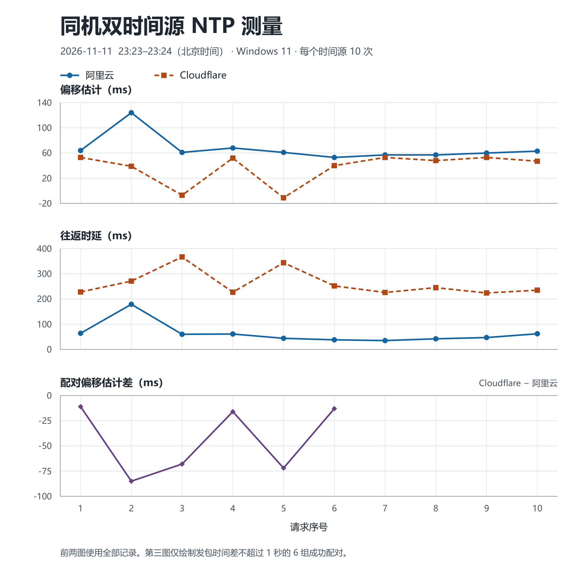

# 实验一　NTP 客户端测试与结果分析

## 测试设置与方法

使用仓库提交 `c2e2604` 中的 Java NTP 客户端和控制台入口。Windows 11、JDK 24 上进行了公网双源采样和本机回归复测。公网采样使用 IPv4 UDP 123，每个源请求 10 次，每次请求结束后等待 5 s，单次接收超时 2 s。阿里云和 Cloudflare 两路均为 `DIRECT_UDP`，采样窗口为 2026 年 11 月 11 日 23:23:31–23:24:19（北京时间）。组内此前在 17:42 完成的阿里云直连数据作为另一轮独立观测。 [阿里云公开时间源](https://www.alibabacloud.com/help/en/ecs/user-guide/alibaba-cloud-ntp-server/) · [Cloudflare 公开时间源](https://developers.cloudflare.com/time-services/ntp/usage/)

| 场景 | 原始记录 |
| --- | --- |
| 组内阿里云直连 | [正式 CSV](../重新实验/直连正式数据.csv) · [运行参数和控制台输出](../重新实验/直连正式运行记录.txt) |
| Windows 同机双源直连 | [阿里云 CSV](原始记录/公网-阿里云.csv) · [Cloudflare CSV](原始记录/公网-Cloudflare.csv) |
| Windows 本机故障复测 | [回归 CSV](原始记录/本机故障回归.csv) · [回归输出](原始记录/本机故障回归.txt) · [复现代码](../tests/NtpRegressionTest.java) |

`T1`、`T2`、`T3`、`T4` 分别为客户端发送、服务器接收、服务器发送和客户端收到有效响应的时间戳。按日志中的 Unix 毫秒复算，偏移 `θ = ((T2 − T1) + (T3 − T4)) / 2`，往返时延 `δ = (T4 − T1) − (T3 − T2)`，应用层校正时间为 `T4 + θ`。偏移为正表示本机时钟估计落后于该源。除法按 Java 整数规则向零截断。程序输出校正后的时间，操作系统时钟保持原样。 [RFC 5905，第 8 节](https://www.rfc-editor.org/rfc/rfc5905.html#section-8) · [日志字段说明](../重新实验/日志复用说明.md)

将有效匹配响应数除以尝试次数得到成功率。偏移和时延统计只使用成功行，失败时缺失的值保留为空。三个公网批次的 **30/30 条成功记录**均通过四时间戳与校正值复算，本机回归 CSV 的 **4/4 条**通过公式或失败字段核对。可在仓库根目录运行 `python "实验1/tests/audit_ntp_log.py" "<CSV 路径>" --output "<临时核对目录>"` 复核任一文件。

## 公网结果

| 采样批次 | 有效 / 尝试 | 偏移均值 ± 样本标准差（ms） | 偏移最小 / 中位 / 最大（ms） | 往返时延最小 / 中位 / 最大（ms） |
| --- | ---: | ---: | ---: | ---: |
| 组内阿里云直连 | 10 / 10 | 287.30 ± 2.26 | 285 / 287 / 291 | 18 / 22 / 28 |
| Windows 阿里云直连 | 10 / 10 | 66.80 ± 20.53 | 53 / 61 / 124 | 35 / 53.5 / 179 |
| Windows Cloudflare 直连 | 10 / 10 | 36.70 ± 24.64 | −11 / 47.5 / 53 | 224 / 240 / 367 |

图 1　两路各自的请求序号用于显示偏移和时延。下图仅显示发包时刻相差不超过 1 s、且两路均成功的同序号配对。

**精度与波动。** 组内第一轮的偏移范围为 285–291 ms，表明该轮相对阿里云的估计较集中。用第 1 条手算，`T2 − T1 = 294 ms`、`T3 − T4 = 276 ms`，得到偏移 +285 ms、时延 18 ms。此时 `T4 = 1794390125173`，校正时间为 `1794390125458`。Windows 阿里云第 2 次请求的往返时延升至 179 ms，偏移为 +124 ms，该轮其余偏移为 +53 至 +68 ms。Cloudflare 的 367 ms 和 344 ms 两个时延较高的样本，偏移分别为 −7 ms 和 −11 ms。高时延样本同时出现较大的偏移变化，值得结合低时延样本核对。仅凭这些数据无法确定变化来自哪一段链路。

四时间戳法用往返路径估计两端偏移。若单次交换内时钟偏移近似固定，去程与回程的单向时延之差有一半会进入偏移估计。时间源自身误差、本机时钟漂移、毫秒量化和记录时间戳时的调度也会影响结果。这里能量化相对偏移及其波动。绝对校正误差需在同一时刻与独立可信时钟对照。在本机受控回归中，模拟端以本机时钟加 100 ms 生成时间戳，成功行复算为 +100 ms、时延 1 ms，验证了这一受控样本中的校正方向和计算。 [本机回归 CSV 第 2 条](原始记录/本机故障回归.csv)

**一致性。** Windows 两路以相同参数从同一台设备发起。由于每路在收到结果后才等待 5 s，实际发包时间逐渐错开。按同序号、两路均成功、`|T1_Cloudflare − T1_阿里云| ≤ 1 s` 配对，前 6 轮满足条件，发包时间差为 23–978 ms。6 组 `θ_Cloudflare − θ_阿里云` 均为负，范围 −85 至 −11 ms，绝对差的中位数为 **42 ms**。这表明在本次网络和采样窗口下，两条路径给出的校正量存在差异。源时钟差和路径不对称均可能影响差值。后 4 轮仍计入各源的单源统计。设备间一致性应在两台设备上同步采样并比较同一时刻的校正读数。时间差可能使跨节点日志按墙钟排序时出现因果顺序颠倒。

**可用性。** 两个公网源在 Windows 这一轮各完成 10/10 次有效取时，无丢弃回包。每个源的成功率都只描述本批短时采样。组内 17:42 的样本来自另一台机器和另一时段，可用来观察另一批表现。两批偏移的差值无法说明客户端改版的效果。

## 故障与恢复

| 测试条件 | Windows 复测结果 | 结论 |
| --- | --- | --- |
| 首次请求无有效响应，超时设为 150 ms | 第 1 条记为 `TIMEOUT`，等待 150 ms，校正字段为空 | 无有效回包时能在期限内返回失败 |
| 下一次请求收到迟到包、短包、未同步包和当前合法包 | 第 2 条丢弃 3 包，其中 1 包的 Origin 与当前请求不匹配，最终成功 | 一次超时后仍可继续取时，旧包不进入本轮计算 |
| 持续收到短包 | 150 ms 期限下实际等待 151 ms，丢弃 10 包后超时 | 无效包流没有重置等待期限 |
| 关闭套接字后尝试发送 | 第 3 条记录 `SEND_FAILED`，发送尝试耗时 1 ms，`sent=false` | 可定位到发送阶段 |
| 输入无效地址 `[invalid]` | 第 4 条记录 `DNS_FAILED`，`sent=false`，日志保留地址处理耗时字段 | 地址失败后没有继续使用上一次的服务器 |

[原始故障 CSV](原始记录/本机故障回归.csv) · [原始回归输出](原始记录/本机故障回归.txt)

旧版第 4 次接收失败后，第 5 次曾报出 −2589 ms 偏移和 5508 ms 时延。旧日志缺少四时间戳和回包匹配信息，成因无法追溯。Windows 受控复测验证了修复版在迟到回包场景下的行为，旧异常留作历史问题记录。 [旧日志](../../ntp_measurements.csv) · [修复说明](../B成员反馈修复说明.md)

## 改进方案与复测设计

1. **降低单次网络波动对校正量的影响。** 每个时间源单独维护最近 8 条有效样本，选择其中时延最低的 3 条，取其偏移中位数作为校正量。窗口内样本不足 3 条时，标注估计依据不足。阿里云第 2 轮及 Cloudflare 第 3、5 轮提供了高时延伴随偏移跳变的实测样例。低时延筛选可以减弱偶发排队的影响，持续的路径不对称仍需独立参考检查。窗口较长也会延缓对真实时钟漂移的响应。 [RFC 5905，第 10 节](https://www.rfc-editor.org/rfc/rfc5905.html#section-10)
2. **提高连续失败后的可用性。** 当主源连续两次超时或出现地址解析失败时，在保持单次等待上限和正常轮询间隔的前提下尝试备用源，记录切换原因及上次有效校正距今的时间。两个源都失败时显示当前同步状态和旧校正值的年龄。切换后用多条有效样本确认新偏移，避免把单次跨源差异直接当成时钟跳变。
3. **用相同输入复测改进效果。** 对过滤方案，使用同一模拟源提供已知偏移，在相同的对称时延、单向排队突增场景下向两版提供相同输入，对比校正误差中位数、95 分位数和收敛所需的采样次数。对切换方案，使用相同的主源停响应与恢复时序，对比有效取时比例、从故障开始到下一次有效取时的时间、最长数据陈旧时间。当前公网数据是基线，以上指标用于改进后的同条件复测。

## 答辩问答

- **287.30 ms 是什么？** 是组内阿里云直连批次对服务器相对本机偏移的平均估计。正值表示按该估计应给本机读数加上相应偏移。
- **两路都 100% 成功，为什么校正量仍不同？** 每路 10/10 成功表示都拿到了有效匹配回包。可配对的 6 轮中，校正量绝对差中位数是 42 ms，源时钟差与两条路径的不对称都会影响它。绝对精度需用独立时钟验证。
- **第 5 条历史异常能确定是旧包吗？** 现有历史日志无法确认。可展示新的本地回归第 1、2 条，说明首轮超时后，次轮丢弃了 1 个 Origin 不匹配回包，并用当前有效回包完成了校正计算。
- **现场怎样说明改进？** 展示图 1 的阿里云第 2 轮，说明高时延样本可能使单次校正量波动。再展示持续短包测试的 151 ms 等待，说明固定期限已验证，后续可在同条件下评估筛选和备用源切换。
