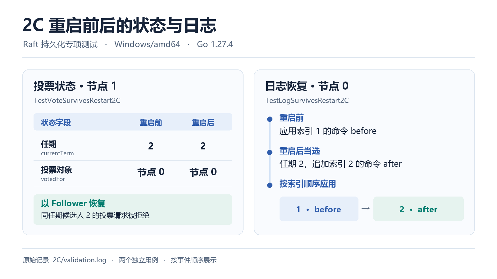

# 2C 重启与回归结果表

本次验证记录于 2026 年 11 月 27 日，环境为 Windows/amd64、Go 1.27.4，采用 baseline 选举参数。用 `Persister` 模拟节点停机后仍可读取的稳定存储。 [原始日志](../validation.log)

## 重启前后状态和日志

下面两项独立测试分别验证投票状态和日志恢复。

| 用例 | 观察项 | 重启前 | 重启后 |
| --- | --- | --- | --- |
| 节点 1 投票恢复 | 任期 `currentTerm` | 2 | 2 |
| 节点 1 投票恢复 | 投票对象 `votedFor` | 节点 0 | 节点 0 |
| 节点 1 投票恢复 | 重启角色及投票结果 | 任期 2 已投给节点 0 | 以 Follower 恢复，拒绝同任期候选人 2 的投票请求 |
| 节点 0 日志恢复 | 应用索引与内容 | 任期 1 应用索引 1 的 `before` | 任期 2 当选并追加 `after`，依次应用索引 1 的 `before` 和索引 2 的 `after` |

[节点 1 原始输出](../validation.log#L7) · [节点 0 原始输出](../validation.log#L12) · [专项测试源码](../../2A/code/6.5840/src/raft/persistence_test.go)

## 集群重启场景

| 用例 | 集群规模 | 故障与重启过程 | 结果 |
| --- | ---: | --- | --- |
| `TestPersist12C` | 3 | 全集群重启，再分别断连和重启 Leader、Follower | 通过。重新连接后继续提交，最终 3 节点应用命令 16 |
| `TestPersist22C` | 5 | 循环模拟分区，依次重启节点并恢复多数派 | 通过。恢复到多数派后能提交，最终 5 节点应用命令 1000 |
| `TestPersist32C` | 3 | 一个 Follower 断连，Leader 和另一个 Follower 崩溃，Leader 先重启 | 通过。恢复到 2 节点时提交 103，3 节点恢复后提交 104 |

重启专项共 5 项，上述 3 项和两项状态对照测试均通过。 [重启专项原始输出](../validation.log#L6) · [集群测试源码](../../2A/code/6.5840/src/raft/test_test.go#L675)

## 2A–2C 回归

| 验证模式 | 2A 选举 | 2B 日志复制 | 2C 持久化 | 合计通过 |
| --- | ---: | ---: | ---: | ---: |
| 普通 | 7/7 | 10/10 | 10/10 | 27/27 |
| `-race` | 7/7 | 10/10 | 10/10 | 27/27 |

2C 回归还覆盖 Figure 8、丢包和节点反复上下线。本次 race 运行未报告数据竞争。 [普通回归输出](../validation.log#L34) · [race 回归输出](../validation.log#L142) · [复现命令](../README.md#运行验证)
