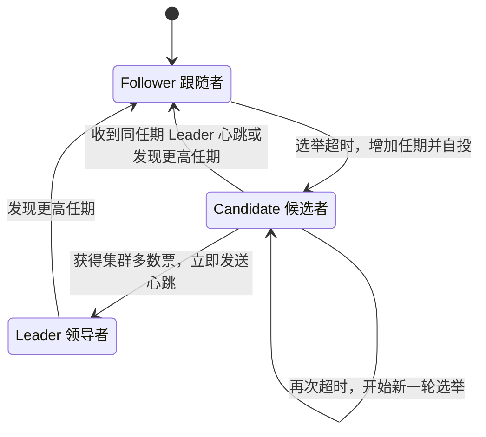
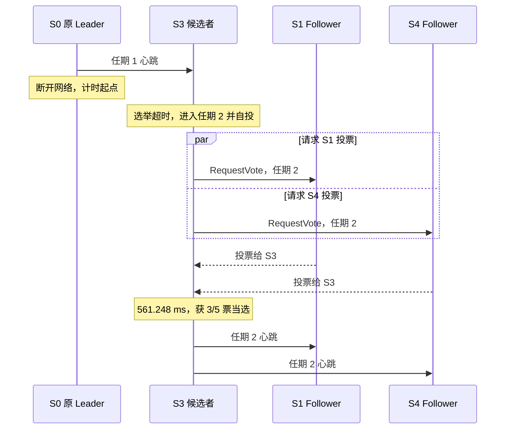
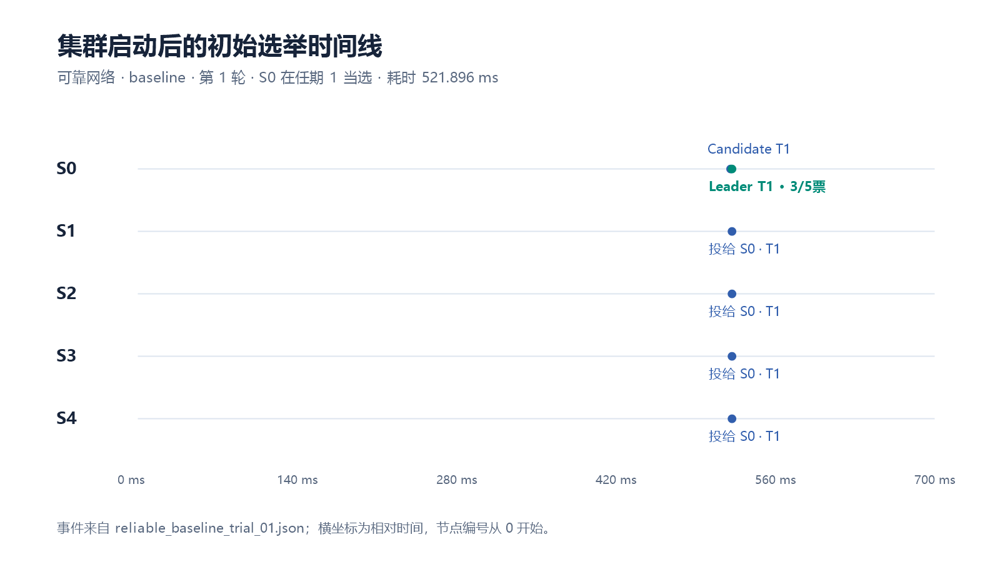
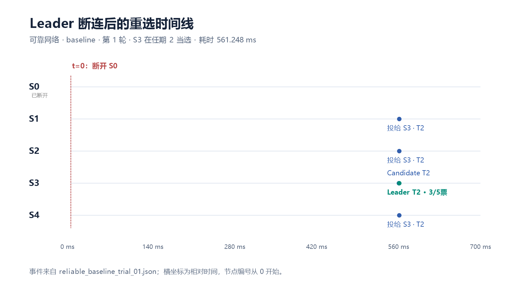

# 分布式系统实验 2 基于 Raft 的选举服务

## 实验目的

实现 Raft 领导选举，观察集群初次选主和 Leader 失联后的重选。通过日志复制、网络分区和节点重启，验证多数派如何影响选举安全性、已提交日志的一致性和集群的写入可用性。

## 实验内容

- **2A 领导选举**。实现随机选举超时、投票、心跳和角色转换，记录初选与故障重选。
- **选举参数改进**。保留固定参数基线，在相同网络和故障条件下对比 baseline、fast、stable 三种配置。
- **2B 日志复制**。实现日志追加、冲突修复、提交和应用，检查节点断连与重连时的行为。
- **2C 持久化与恢复**。保存任期、投票和日志，验证重启后仍能遵守投票规则并继续提交命令。
- **Paxos 与 Raft 对比**。根据论文比较基本 Paxos、Multi-Paxos 与 Raft，并回答三道选做题。

## 实验总体思路

### 领导选举

节点启动时为 Follower。选举超时后，它增加任期、自投并向其他节点发出 `RequestVote`。票数超过集群总节点数一半时，该候选人成为 Leader 并发送 `AppendEntries` 心跳。节点在同一任期至多投给一名候选人，任意两个多数派存在交集，因此同一任期至多选出一个 Leader。投票时还比较候选人最后一条日志的任期和索引，任期优先。 [Raft 论文图 2、图 4 和第 5.4.1 节](https://raft.github.io/raft.pdf)

### Leader 断连后重选

可靠网络 baseline 第 1 轮中，S0 在任期 1 取得 3/5 票。断开 S0 后，S3 率先超时，在任期 2 计入 S1、S4 的两票和自己的票，故障注入后 561.248 ms 当选。其余节点仍按原 5 节点集群的多数派阈值投票。 [该轮原始事件](2A/results/raw/traces/reliable_baseline_trial_01.json)

### 日志复制与提交

Leader 接收 `Start()` 后追加带任期的条目。Follower 检查 `PrevLogIndex` 和 `PrevLogTerm`，返回冲突位置或接受条目。Leader 依据答复调整 `nextIndex` 并重试。当前任期的条目复制到多数派后，Leader 才能据此推进 `commitIndex`。Follower 从后续 `AppendEntries` 获知提交位置，各节点按索引顺序通过 `applyCh` 交付已提交命令。 [Raft 论文第 5.3、5.4 节](https://raft.github.io/raft.pdf)

### 持久化与恢复

`currentTerm` 记录节点见过的最高任期，`votedFor` 记录当前任期投给谁，`log` 保存命令及其写入时的任期。恢复前两项可防止任期回退和重启后重复投票。恢复日志可保留先前的条目，为选举时的日志新旧比较及复制时的前缀检查提供依据。 [Raft 论文图 2](https://raft.github.io/raft.pdf)

实验以 `Persister` 模拟稳定存储。在共享锁内用 `labgob` 将三项状态编码为一份字节数据，再通过 `Save` 一次写入。接收或发现更高任期、开始竞选、授予新选票、追加或修复日志时，在对外响应或发送相应请求前保存。`MakeWithConfig()` 先读回持久状态，再启动选举和应用协程。重启角色为 Follower，`commitIndex`、`lastApplied` 从 0 开始推进。节点再次当选时，按恢复后日志的尾部重新初始化复制索引。 [2C 实现与验证](2C/README.md)

## 实验过程

| 项目 | 实现与验证步骤 | 代码与材料 |
| --- | --- | --- |
| 2A 领导选举 | 启动集群记录初选，断开当时 Leader，记录从断连到新 Leader 当选的时间。检查当选票数和同任期的当选节点 | [选举与心跳](2A/code/6.5840/src/raft/election.go)、[采集测试](2A/code/6.5840/src/raft/election_experiment_test.go) |
| 选举参数改进 | 保留固定基线。用 5 节点分别在可靠网络、丢包与回复延迟网络下运行三种配置，每组 10 轮。每轮先观察 2 秒，再断开 Leader | [可切换参数](2A/code/6.5840/src/raft/election_config.go)、[基线与改进说明](2A/docs/implementation-and-improvement.md) |
| 2B 日志复制 | 验证正常复制、Follower 重连追赶、Leader 切换和失去多数派。检查提交位置和各副本在相同索引应用的值 | [日志与应用](2A/code/6.5840/src/raft/raft.go)、[复制与冲突处理](2A/code/6.5840/src/raft/election.go)、[B 的交接记录](2B/成员B过程记录与C交接.md) |
| 2C 持久化 | 复用 2A、2B 的任期、投票和日志字段。用同一份 `Persister` 重建测试节点，检查恢复字段、同任期投票和日志重放，再用课程测试模拟多节点崩溃与恢复 | [保存与启动恢复](2A/code/6.5840/src/raft/raft.go)、[重启专项测试](2A/code/6.5840/src/raft/persistence_test.go) |

| 选举配置 | 心跳间隔 | 随机选举超时 | 用途 |
| --- | ---: | ---: | --- |
| baseline | 120 ms | [450, 750) ms | 复用固定基线的计时参数 |
| fast | 100 ms | [300, 500) ms | 缩短检测 Leader 失联的等待 |
| stable | 150 ms | [800, 1200) ms | 为 RPC 延迟和重试预留较长时间 |

三种配置每 10 ms 检查一次超时。对照实验的重选耗时从故障注入起计至新 Leader 当选，选举轮数按发起竞选的任期计数。通过 `RAFT_ELECTION_PROFILE` 切换配置。 [实验复现命令](2A/README.md) [数据口径](2A/docs/data-dictionary.md)

## 实验结果

### 初选和重选

可靠网络 baseline 第 1 轮中，S0 在启动后 **521.896 ms** 以 **3/5** 票当选任期 1 的 Leader。断开 S0 后，S3 在 **561.248 ms** 后以 **3/5** 票当选任期 2 的 Leader。60 轮试验均记录到初选和重选，采集检查通过了多数票和同任期唯一当选节点的约束。 [事件与试验数据](2A/results/experiment-results.md)

### 选举参数对照

| 网络 | 配置 | 成功轮数 | 平均初选 ms | 平均重选 ms | 重选 P95 ms | 平均重选轮数 | 观察窗口换主次数 |
| --- | --- | ---: | ---: | ---: | ---: | ---: | ---: |
| 可靠 | baseline | 10/10 | 501.54 | 507.36 | 570.44 | 1.0 | 0 |
| 可靠 | fast | 10/10 | 352.07 | 278.35 | 611.07 | 1.1 | 0 |
| 可靠 | stable | 10/10 | 868.34 | 837.13 | 905.68 | 1.0 | 0 |
| 丢包与回复延迟 | baseline | 10/10 | 757.89 | 1220.47 | 4636.03 | 2.2 | 0 |
| 丢包与回复延迟 | fast | 10/10 | 593.74 | 1149.08 | 2892.86 | 3.2 | 0 |
| 丢包与回复延迟 | stable | 10/10 | 1171.86 | 2028.89 | 3523.80 | 1.8 | 0 |

每组无主动故障的观察时间约为 20 秒，六组累计约 120 秒。对照数据来自 A 的同机 `labrpc` 实验，采集时启用了 Go race 检测。 [统计表](2A/results/tables/summary.csv) [重选耗时图](2A/results/figures/03_reelection_latency.png) [选举轮数图](2A/results/figures/04_election_rounds.png) [换主次数图](2A/results/figures/05_unexpected_leader_changes.png)

### 2B 日志复制与故障

| 场景 | 用例 | 回归结果 |
| --- | --- | --- |
| 正常复制 | `TestBasicAgree2B` | 3 节点依次应用命令 100、200、300，返回的日志索引为 1、2、3 |
| Follower 断连后重连 | `TestFailAgree2B` | 断连期间 2 个节点对命令 102–105 达成一致，重连后 3 个节点都能提交并应用新命令 106、107 |
| Leader 失联 | `TestLeaderFailure2B` | 第一个 Leader 断连后，剩余 2 个节点可以提交 102、103。再隔离当前 Leader 后，命令 104 未提交 |
| 失去多数派 | `TestFailNoAgree2B` | 5 节点中的 3 个 Follower 断连后，`Start(20)` 返回索引 2，但已提交副本数为 0。恢复通信后 5 个节点均可提交命令 1000 |
| 分区合并与冲突回退 | `TestRejoin2B`、`TestBackup2B` | 旧 Leader 重连后可继续复制，存在分歧的日志通过冲突提示修复 |

10 项 2B 课程用例全部通过，覆盖故障、并发追加及 RPC 数量和字节数检查。 [测试源码](2A/code/6.5840/src/raft/test_test.go) [回归输出](2C/validation.log)

### 2C 重启与恢复

| 用例 | 实测结果 |
| --- | --- |
| `TestVoteSurvivesRestart2C` | 节点 1 重启前后均为任期 2、投票对象 0。恢复为 Follower 后，拒绝同任期候选人 2 的请求 |
| `TestLogSurvivesRestart2C` | 节点 0 在任期 1 应用索引 1 的 `before`。重启后在任期 2 当选，追加索引 2 的 `after`，依次应用索引 1 和 2 |
| `TestPersist12C`、`TestPersist22C`、`TestPersist32C` | 全员或单节点重启、反复分区与重启，以及 Leader 和一个 Follower 崩溃后的恢复均通过。多数派恢复后能继续提交新命令 |

5 项重启专项验证全部通过。Figure 8、丢包和节点反复上下线用例补充了随机故障下的 2C 覆盖。使用 Go 1.27.4 在 Windows/amd64 上回归 2A–2C，27 项用例在普通运行和 `-race` 下均通过。 [2C 验证记录](2C/README.md#验证结果) [原始测试输出](2C/validation.log)

## 效果和问题分析

- **一致性**。多数票和任期规则限制了同一任期的 Leader。日志冲突通过匹配前缀和回退复制位置来修复。节点短暂断连可以落后，重连后按提交顺序追赶。用例检查了相同索引的命令以及应用顺序，验证范围是实验的 Raft 日志与应用接口。 [2B 测试源码](2A/code/6.5840/src/raft/test_test.go)
- **可用性与容错性**。三节点集群仍有两个可通信节点时，能在 Leader 故障后重选并继续提交。五节点只剩两个互通时，本地仍可能接收命令，但多数确认无法完成。恢复通信后，未提交的冲突日志可能被新 Leader 的日志覆盖。节点重启时读回持久状态，避免把已经写入的日志和投票当成首次启动。 [2B 与 2C 回归输出](2C/validation.log)
- **恢复速度与稳定性的取舍**。可靠网络下 fast 的平均重选比 baseline 快约 45.1%，但它的 P95 为 611.07 ms，高于 baseline 的 570.44 ms。丢包与回复延迟场景下，stable 平均重选轮数为 1.8，少于 fast 的 3.2，但平均耗时增加到 2028.89 ms。六组短观察窗口均为 0 次换主，证据只覆盖这批样本。 [成员 A 的结果与分析](2A/docs/member-a-report.md)
- **存储开销**。每次持久状态改变时编码完整日志，日志变长后写入成本也会上升。对未改变持久状态的心跳和同一候选人的投票重试跳过编码。实验的 `Persister` 模拟重启恢复所需的稳定存储，测量范围为课程进程内的节点故障。 [持久化实现](2C/README.md)

## 相关问题回答

### 1. 可以用 Raft 做什么

Raft 可以为分布式键值存储、配置服务等复制状态机维护一份有共同提交顺序的操作日志。Leader 协调副本复制操作，各副本按同一顺序执行确定性命令，因此可重建一致的状态。Leader 宕机时，只要多数节点仍能及时通信，集群就能选出下一任 Leader 并继续处理写入。 [Raft 论文第 2、5 节](https://raft.github.io/raft.pdf)

### 2. 只有少数节点活动时，集群能否继续运行

节点进程和部分本地操作能继续运行。固定配置下，选出新 Leader 或提交新条目需要至少 ⌊N/2⌋ + 1 个节点。五节点实验中，Leader 与一个 Follower 互通时，Leader 能在本地追加命令 20，但索引 2 的提交计数保持为 0。多数派恢复后，全集群可再次达成一致。 [`TestFailNoAgree2B` 源码](2A/code/6.5840/src/raft/test_test.go#L303)

### 3. 什么是拜占庭问题，它会使 Raft 失效吗

拜占庭问题讨论部分参与者可以任意偏离协议时，正确参与者如何达成一致。例如，故障节点可以向不同邻居发送互相矛盾的投票。Raft 假设节点遵循协议，允许节点停止、重启或失联。三节点集群中，若 S1 在同一任期同时投给 S0 和 S2，后两者都可能各凭自投与 S1 的票得到 2/3 多数，同任期唯一 Leader 的保证便失效。 [Raft 论文第 2、5.2 节](https://raft.github.io/raft.pdf)

### 4. 为什么随机设置选举超时

相同固定超时可能让多名 Follower 同时竞选，自投后分散选票，下一轮也可能同时超时。随机抽取超时让某节点有机会先拿到多数票并发出心跳。每轮重新抽样也能打破连续分票，主要改善选举收敛性。选举安全性仍靠每任期投票约束与多数派交集。 [Raft 论文第 5.2 节](https://raft.github.io/raft.pdf)

### 5. 选举超时设置太小有什么影响

心跳经过正常的网络延迟、丢包或调度波动也可能错过超时。Follower 会提前竞选，旧 Leader 看到更高任期后退位，频繁换主会增加 RPC 并影响服务。较短窗口也可能让多名候选人接近同时发起选举。在丢包与回复延迟的对照组，fast 平均需要 3.2 轮，baseline 为 2.2 轮。论文建议使广播时间远小于选举超时，选举超时又远小于节点的平均故障间隔。 [选举对照数据](2A/results/experiment-results.md) [Raft 论文第 5.6 节](https://raft.github.io/raft.pdf)

### 选做 Paxos 与 Raft 对比

| 对比项 | Raft | 基本 Paxos / Multi-Paxos |
| --- | --- | --- |
| 共识对象 | 整份复制日志的顺序和内容 | 基本 Paxos 决定一个值，Multi-Paxos 用一系列实例组织日志 |
| 逻辑角色 | Follower、Candidate、Leader | Proposer、Acceptor、Learner，Multi-Paxos 常使用稳定 Leader |
| 安全依据 | 任期、选举多数票、日志新旧检查和前缀匹配 | 提案编号、多数派交集，以及继承最高编号已接受值的规则 |
| 稳定请求路径 | Leader 将条目复制到多数副本 | Multi-Paxos 复用准备阶段，在后续位置执行接受阶段 |

1. **什么是 Paxos？** 基本 Paxos 用提案编号和两阶段协议让参与者对一个值达成一致。提议者先向多数接受者获取承诺和旧提案。有旧提案时，沿用编号最高的已接受提案的值。没有旧提案时，可以提出自己的值。该提案被多数接受后，值即被选定。Multi-Paxos 将多个实例组织为复制日志。 [Paxos Made Simple 第 2、3 节](https://pdos.csail.mit.edu/6.824/papers/paxos-simple.pdf)
2. **哪个更简单？** 对本实验的复制日志任务，Raft 有清晰的选举、复制、恢复接口和强 Leader 的日志流向，代码与故障场景可逐项对应。基本 Paxos 的单值机制较精炼，扩展到连续请求时还要处理日志空洞、多个实例和 Leader 切换。 [Raft 论文第 3、9.3 节](https://raft.github.io/raft.pdf)
3. **实际性能怎样比较？** 合理的比较对象是 Raft 与 Multi-Paxos。Leader 稳定时，两者常见路径都可以用一轮通信向多数副本推进新条目。批处理、流水线、存储延迟、网络 RTT 和故障切换都会影响吞吐与延迟。本组的毫秒数来自 Raft 选举对照，Paxos 性能讨论依据论文机制。 [Paxos Made Simple 第 3 节](https://pdos.csail.mit.edu/6.824/papers/paxos-simple.pdf) [成员 A 的完整问答](2A/docs/questions-and-paxos.md)

## 体会和建议

- 断连、停机和重启需要分别验证。断连保留本地状态，重启会重建 Raft 对象。验证恢复时应检查任期、投票和日志，还要观察重新选举与后续提交。
- 接入持久化时，最容易漏掉的是拒绝 RPC 前的任期更新。即使日志前缀不匹配或候选人日志过旧，只要接收了更高任期，就需要保存新任期和清空后的投票状态。
- 继续评价参数改进时，可延长无故障观察时间，增加随机种子并独立改变丢包率和延迟。将故障注入时刻、当选票数和提交索引同时记录，有利于区分重选慢和复制追赶慢。
