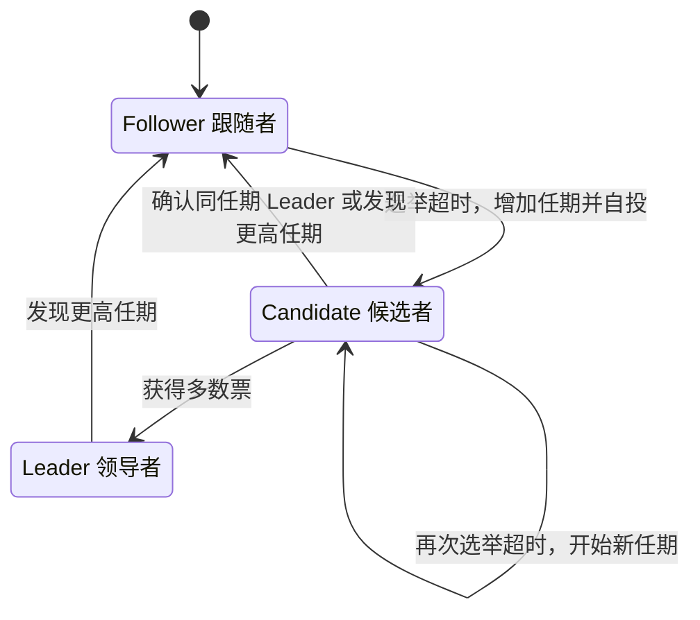
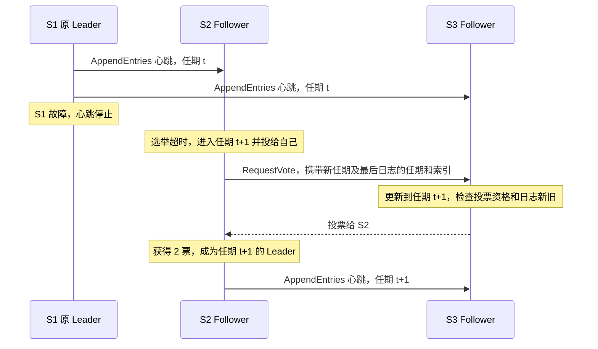

# 分布式系统实验 2 基于 Raft 的选举服务

## 实验目的

理解 Raft 如何通过任期、投票和心跳选出领导者。通过初始选举和 Leader 故障后的重选观察多数派的作用，再用日志复制和节点重启实验检验故障发生前后的日志一致性与服务可用性。

## 实验内容

- **领导选举（2A）**。实现初始选举，模拟 Leader 故障，记录剩余节点如何选出新 Leader。
- **选举改进**。选取基线和改进版本，在相同条件下比较重选耗时、选举轮数和非预期换主次数。
- **日志复制（2B）**。实现追加、冲突处理、提交和应用，验证断开节点恢复连接后能追赶日志。
- **持久化与恢复（2C）**。保存任期、投票状态和日志，验证节点重启恢复后能参与选举和日志复制。
- **Paxos 与 Raft 对比**。比较两者的设计和实际性能，并回答三道选做题。

## 实验总体思路

### Raft 角色转换

节点启动时进入 Follower 状态。选举、复制和退位都受任期约束。进入 2B 后，投票还要检查候选人的日志是否足够新，先比最后一条日志的任期，任期相同再比最后一条日志的索引。 [Raft 论文图 2、图 4 和第 5.4.1 节](https://raft.github.io/raft.pdf)

### Leader 故障后重新选举

三节点示例中，S1 故障后，S2 和 S3 仍可通信。S2 率先超时，且它的日志满足投票条件。实验时用观测到的节点编号、任期和时间替换示例数据。 [Raft 论文第 5.2 节](https://raft.github.io/raft.pdf)

### 2C 持久化原理

节点需要记住见过的最高任期 `currentTerm` 和当前任期投票对象 `votedFor`，以便重启后仍遵守任期和投票约束。保存完整日志能保留恢复前的条目，也为后续选举和日志匹配提供依据。恢复后，提交索引和应用进度由运行中的 Raft 推进。 [Raft 论文图 2 和第 5.4 节](https://raft.github.io/raft.pdf)

实验用 `Persister` 模拟稳定存储。保存时将三个持久字段一起用 `labgob` 编码。重启时，`Make()` 在启动选举协程前读回已保存的字节，解码成功后恢复这三个字段。 [2C 接入说明](2C/README.md)

## 实验过程

| 项目 | 方案与验证步骤 | 代码位置 |
| --- | --- | --- |
| 2A 领导选举 | 启动集群观察初选，再断开当前 Leader，观察剩余节点重选 | 待 A 补充 |
| 选举改进 | 保留 2A 基线，采用相同节点数、负载和故障条件运行两版 | 待 A 补充改进方案及位置 |
| 2B 日志复制 | 提交命令，分别验证正常复制、Follower 重连、Leader 切换及少数派场景 | 待 B 补充 |
| 2C 持久化 | 在 2A、2B 集成版本中接入持久化。提交命令后模拟节点重启，检查恢复结果与后续选举和提交 | [补丁](2C/raft-persistence.patch)中的 `src/raft/raft.go`，重点是 `persist()`、`readPersist()` 和 `Make()` |

## 实验结果

| 项目 | 记录内容 | 实测结果和证据 |
| --- | --- | --- |
| 2A 领导选举 | 初选与重选节点编号、任期、耗时和故障注入时刻 | 待 A、B 汇总 |
| 选举改进 | 基线与改进版本的重选耗时、选举轮数和非预期换主次数 | 待 A、B 汇总 |
| 2B 日志复制 | 断连与重连前后的日志索引、提交和应用进度，失去多数派时的现象 | 待 B 补充 |
| 2C 持久化 | 重启前后的任期、投票和日志，恢复后重新选举和提交新命令的测试结果 | 骨架上的保存与恢复检查通过。集群测试待合入 2B 后补充。 [检查记录](2C/README.md#骨架验证) |

## 效果和问题分析

- **选举与改进**。根据初选和重选日志判断新 Leader 是否取得多数票。结合对照数据讨论改进在重选速度与稳定性上的取舍。待 A、B 补充。
- **2B 日志复制**。对照相同索引已提交的命令，分析断连节点如何追赶，以及失去多数派时提交能否继续。待 B 补充。
- **2C 持久化**。对照重启前后的三个持久字段与重启后的选举、提交结果。如果出现任期回退、重复投票或日志丢失，检查相应修改路径是否在释放锁和响应前保存了状态。待联调补充。

## 相关问题回答

### 1. 可以用 Raft 做什么

Raft 可用于构建由多台机器共同提供服务的复制状态机，例如分布式键值存储和配置服务。Leader 协调各副本复制操作日志，各副本按相同顺序应用已提交的命令。当前 Leader 故障时，只要多数节点仍能通信且通信足够及时，集群就能重新选出 Leader 并继续处理更新。 [Raft 论文第 2、5 节](https://raft.github.io/raft.pdf)

### 2. 只有少数节点处于活动状态时，集群能否继续运行

待 B 结合少数派故障实验填写，说明节点运行和集群继续选举、提交日志各自需要的条件。

### 3. 什么是拜占庭故障，它会使 Raft 失效吗

拜占庭故障指节点任意偏离协议，例如向不同节点发送互相矛盾的消息。Raft 的安全性建立在节点遵守协议的故障模型上，允许节点宕机、重启或暂时失联。在三节点集群中，如果一个故障节点在同一任期同时给另外两名候选人投票，两名候选人都可能凭自己的票和来自故障节点的一票获得多数。此时同一任期最多一个 Leader 的保证就会失效。 [Raft 论文第 2、5.2 节](https://raft.github.io/raft.pdf)

### 4. 为什么随机设置选举超时

待 A 结合选票分散和多轮选举填写。

### 5. 选举超时设置太小有什么影响

待 A 结合心跳间隔和改进对照结果填写。

### 选做 Paxos 与 Raft 对比

待 A 提供对比和以下三题的答案。

1. 什么是 Paxos？
2. Paxos 和 Raft 哪个更简单，为什么？
3. 在实际应用中，Raft 的性能与 Paxos 相比如何？

## 体会和建议

待三人结合实现与实测补充。可以记录一个具体的故障或失败用例、定位过程和实验中仍需改进的地方。
